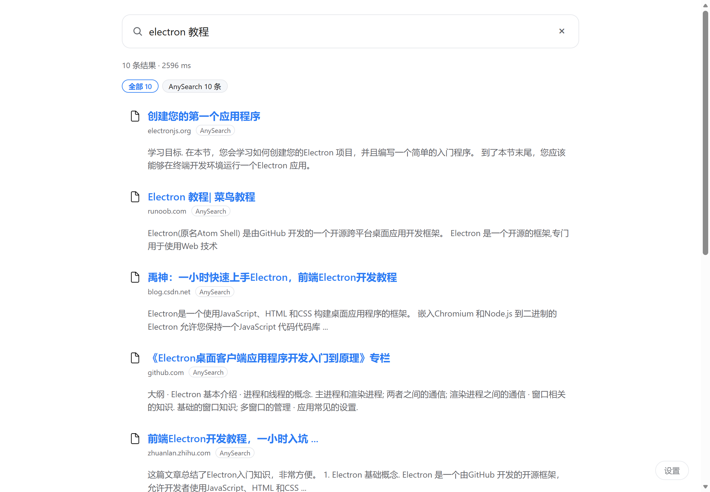
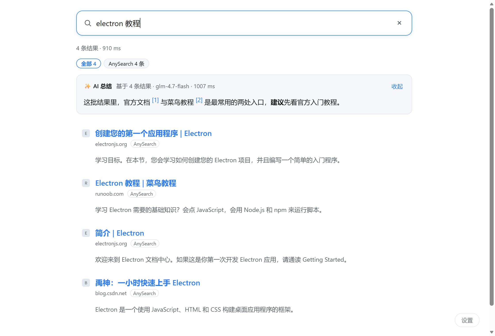
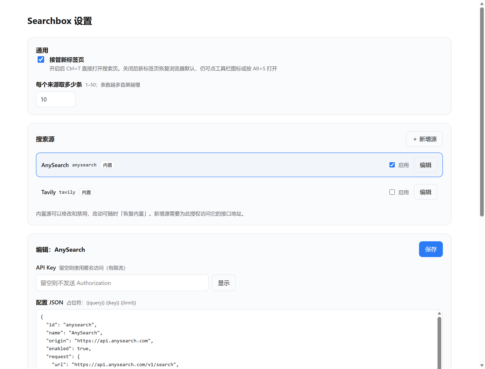

# Searchbox

把 JSON 搜索 API 变成浏览器里的搜索结果页。插件是解释器，搜索源是可配置数据。



## 安装

1. 打开 `edge://extensions`（或 `chrome://extensions`），开启「开发人员模式」
2. 「加载解压缩的扩展」→ 选择本仓库的 **`searchbox/`** 子目录

### 油猴版（不用装扩展）

同一个搜索页也有 Tampermonkey 版本：装脚本后打开 [宿主页](https://afeygu.github.io/searchbox/searchbox_script/host.html) 即可使用，适合不想开开发者模式或非 Chrome 浏览器。



代码在 [searchbox_script/](searchbox_script/)，与扩展版共用同一套核心逻辑（改一处两边生效）。

3. `Ctrl+T` 打开新标签页，应看到搜索框

## 使用

**打开搜索页有三种方式**：

| 方式 | 说明 |
|---|---|
| `Ctrl+T` | 需要开启「接管新标签页」；焦点直接落在搜索框里 |
| 点工具栏图标 | 任何时候都可用，不依赖上面的开关；已有搜索页会直接切过去，不会开重复标签 |
| `Alt+S` | 快捷键，同上。可在 `edge://extensions/shortcuts`（Chrome 为 `chrome://extensions/shortcuts`）改键 |

> `Ctrl+T` 走的是"扩展重建标签页"：新建一个搜索页标签、再关掉浏览器原本那个，焦点因此能落在搜索框。若某次焦点仍在地址栏，按一下 `Esc` 把焦点交还页面即可。

**页面内操作**：

| 操作 | 说明 |
|---|---|
| 输入后回车 | 搜索；结果按来源名次交错合并，跨源重复链接只保留一条 |
| `↑` `↓` | 在结果间移动 |
| `Enter` / `Ctrl+Enter` | 当前标签打开 / 新标签打开 |
| `Esc` | 清空并回到首页 |
| 点来源标签 | 只看这一家的原始结果（不做跨源去重），再点一次回到「全部」 |
| 结果上的来源标签 | 一条链接被多个源同时收录时会并列显示（超过 3 个用「+N」折叠） |
| 划词右键 | 「用 Searchbox 搜索」→ 新标签页直接出结果 |
| 右下角「设置」 | 配 key、编辑源、调「每个来源取多少条」、跑单源测试 |

## AI 总结

搜索结果上方可以自动生成一段总结，**流式输出**，引用编号 `[1]` `[2]` 可点击跳到对应结果。

### 开启方式

设置页 → 「AI 总结」→ 填两个字段就能用：

| 字段 | 说明 |
|---|---|
| 接口地址 | OpenAI 兼容的 `chat/completions` 地址 |
| 模型名 | 例如 `glm-4.7-flash` |

另外两个可选：**API Key**（本地模型可留空）、**提示词**（留空用默认）。
填好保存即生效——**没有开关**，清空地址与模型即关闭。

### 行为

- 结果**先渲染**，总结在后台独立跑，慢也不会挡住结果
- **等所有来源都返回之后**才开始总结（含失败与超时的源）——不用半截结果下结论；因此慢源会推迟总结，但不会拖慢结果展示
- 逐字追加，出字就开始显示
- 失败只在卡片里提示，**不影响搜索结果**；卡片上有「重新总结」
- 默认把前 10 条结果（标题 + 域名 + 摘要 200 字内）送给模型，条数可调 1–30

### 可以直接用的配置

| 服务 | 接口地址 | 模型名 | 说明 |
|---|---|---|---|
| **智谱** | `https://open.bigmodel.cn/api/paas/v4/chat/completions` | `glm-4.7-flash` | **免费**，128K 上下文 |
| DeepSeek | `https://api.deepseek.com/chat/completions` | `deepseek-chat` | 约 0.003 元/次 |
| OpenAI | `https://api.openai.com/v1/chat/completions` | `gpt-4o-mini` | 需自备 key |
| Ollama（本地） | `http://localhost:11434/v1/chat/completions` | 本地模型名 | 无需 key，**数据不出本机**；需授权 `localhost` |

保存时会为接口地址申请访问权限，点允许即可。

### 隐私

开启后，**你的查询词和结果摘要会发送给你配置的模型服务方**。在意这一点就选本地 Ollama，或者不填配置。

### 提示词

默认提示词要求模型：只依据给出的结果作答、不编造、200 字内、用 `[1][2]` 标注来源。可以在设置页改。

## 配置编写指南

一个"搜索源"就是两件事：**怎么发一次请求** + **怎么从响应里取出结果**。全程不写代码。

设置页长这样：



### 一个源由哪些字段组成

| 字段 | 必填 | 说明 |
|---|---|---|
| `id` | 否 | 唯一标识。留空则按 `name` 生成 |
| `name` | 是 | 显示名，也是结果卡片上的来源标签 |
| `type` | 否 | `json`（默认）或 `html` |
| `origin` | 建议 | 需要授权的域名，字符串或数组。不写则用 `request.url` 的域名 |
| `enabled` | 否 | 是否启用，默认 `true` |
| `request` | 是 | 怎么发请求，见下 |
| `response` | 是 | 怎么取结果，见下 |
| `limits.timeoutMs` | 否 | 超时毫秒数，默认 10000 |

`request`：

| 字段 | 必填 | 说明 |
|---|---|---|
| `url` | 是 | 请求地址，可含占位符 |
| `method` | 否 | `GET` 或 `POST`，默认 `GET` |
| `headers` | 否 | 请求头键值对，值可含占位符 |
| `body` | 否 | 请求体对象，会按 JSON 发送；`GET` 时不发 |

`response`（`type` 为 `json`）：

| 字段 | 必填 | 说明 |
|---|---|---|
| `itemsPath` | 是 | 结果数组在响应里的路径，点号分隔，如 `data.results` |
| `fields.title` | 否 | 标题路径，可写数组依次兜底 |
| `fields.url` | 是 | 链接路径 |
| `fields.snippet` | 否 | 摘要路径，可写数组兜底 |
| `okPath` / `okValue` | 否 | 成功判定：`okPath` 取到的值等于 `okValue`（默认 0）才算成功 |
| `errorPath` | 否 | 失败时从哪个字段取错误信息 |
| `captureKeyPath` | 否 | 响应里回传新 key 时自动保存 |

`response`（`type` 为 `html`）：

| 字段 | 必填 | 说明 |
|---|---|---|
| `items` | 是 | 每条结果的容器 CSS 选择器 |
| `fields.title` / `url` / `snippet` | `url` 必需 | **相对于容器**查找；写成 `选择器@属性` 取属性 |

### 占位符

只有三个：`{{query}}`、`{{key}}`、`{{limit}}`。

- **整串就是一个占位符时保留原始类型**。`"max_results": "{{limit}}"` 会发出数字 `10`，而不是字符串 `"10"`——很多接口对数字做类型校验，这点很关键
- **值是空的就整个字段省略**。`Authorization: "Bearer {{key}}"` 在没填 key 时整条请求头都不发，于是自动走匿名；body 里的字段同理
- **嵌在文字里时拼成字符串**，如 `"Bearer {{key}}"`、`"q={{query}}&page=1"`

### 为什么必须写 origin

扩展页面要请求某个域名，必须持有该域名的访问权限。保存源时，设置页会就 `origin` 里的**所有域名**一次性弹出授权请求，点允许即可。

**重定向要额外授权**：`https://www.bing.com` 会 302 到 `https://cn.bing.com`，两个都要写进 `origin`，否则请求会直接失败，而且错误信息看不出原因。

### 调试：三步法

1. 设置页选中该源，在「测试」里输入一个关键词，点「跑一次」
2. 左边是**原始响应**（JSON 或 HTML 原文），右边是**解析出的结果**
3. 对不上就改配置再跑，直到右边出现你想要的条目

常见提示的含义：

| 提示 | 含义 |
|---|---|
| `失败：HTTP 404/400` | 地址或参数不对 |
| `失败：HTTP 401/403` | key 无效或缺失 |
| `未取到结果数组：xxx` | `itemsPath` 写错，或者该接口把结果放在别的字段 |
| `选择器匹配到 0 条` | HTML 选择器失效，或这次确实没有结果 |

### 完整示例

#### 1）AnySearch：JSON 源，免 key

```jsonc
{
  "id": "anysearch", "name": "AnySearch",
  "origin": "https://api.anysearch.com",
  "request": {
    "url": "https://api.anysearch.com/v1/search", "method": "POST",
    "headers": { "Authorization": "Bearer {{key}}" },
    "body": { "query": "{{query}}", "max_results": "{{limit}}" }
  },
  "response": {
    "okPath": "code", "okValue": 0, "errorPath": "message",
    "itemsPath": "data.results",
    "fields": { "title": ["title"], "url": ["url"], "snippet": ["snippet", "content"] }
  }
}
```

#### 2）Serper：拿到 Google 的结果，JSON 源，需要 key

想要"Google 的结果质量"又不想自己跟反爬纠缠，就用它：Serper 在服务端取 Google 结果，返回干净的 JSON，**链接是真实地址**。注册送 2500 次，不用信用卡。

```jsonc
{
  "id": "serper", "name": "Google(Serper)",
  "origin": "https://google.serper.dev",
  "request": {
    "url": "https://google.serper.dev/search", "method": "POST",
    "headers": { "X-API-KEY": "{{key}}" },
    "body": { "q": "{{query}}", "num": "{{limit}}" }
  },
  "response": {
    "itemsPath": "organic",
    "fields": { "title": ["title"], "url": ["link"], "snippet": ["snippet"] }
  }
}
```

注意字段名是 `link` 不是 `url`（和 Google 官方接口一样的历史遗留）。

#### 3）Google：走官方 JSON 接口，需要 key + cx

> 实测（同一浏览器、网络正常时）：
>
> - 陌生客户端的**第一次**请求 → 返回约 90 KB 的 `enablejs` 过渡页，可见文字只有 58 个字符，**没有任何结果**
> - 先正常访问过一次搜索页之后，同样的请求 → 返回约 590–720 KB，含 10 个结果标题
>
> 但即使拿到真结果也不适合做源：`#rso div.MjjYud` 下 18 个容器里只有 9 个是真结果（第一个是广告），摘要只带出 7 条，链接被包装成 `/goto?url=<不透明串>`，真实地址只出现在 `<cite>` 里且常常只有域名。
>
> 更麻烦的是**形态不稳定**：连续请求会在两种页面之间跳动——一种约 585 KB 带 `#rso` 容器（链接是 `/goto`），另一种约 65 KB 完全没有 `#rso`（结果在别的结构里）。选择器没法同时命中两种形态。
>
> 结论：Google 用官方接口；想抓网页，Bing 才是合适的对象。

准备两样东西：Cloud Console 里启用 Custom Search API 得到 **key**；[programmablesearchengine.google.com](https://programmablesearchengine.google.com/) 建一个搜索引擎（勾"搜索整个网络"）得到 **cx**。

```jsonc
{
  "id": "google", "name": "Google",
  "origin": "https://www.googleapis.com",
  "request": {
    "url": "https://www.googleapis.com/customsearch/v1?key={{key}}&cx=你的CX&q={{query}}&num={{limit}}",
    "method": "GET"
  },
  "response": {
    "itemsPath": "items",
    "fields": { "title": ["title"], "url": ["link"], "snippet": ["snippet"] }
  }
}
```

三个注意点：`num` 上限是 10；链接字段叫 **`link`** 不是 `url`；零结果时响应里根本没有 `items` 字段。

#### 4）Bing：抓网页，免 key

```jsonc
{
  "id": "bing", "name": "Bing", "type": "html",
  "origin": ["https://www.bing.com", "https://cn.bing.com"],
  "request": {
    "url": "https://www.bing.com/search?q={{query}}&count={{limit}}",
    "method": "GET",
    "headers": { "Accept-Language": "zh-CN,zh;q=0.9" }
  },
  "response": {
    "items": "li.b_algo",
    "fields": {
      "title": "h2 a",
      "url": "h2 a@href",
      "snippet": [".b_lineclamp", ".b_caption p"]
    }
  }
}
```

实测：返回 200、10 条结果，最终跳转到 `cn.bing.com`（所以 `origin` 必须写两个）。

#### 5）其他家能不能抓

同一套方法可以套到别的引擎/站点上，但**能不能抓取决于它的结果页是否服务端渲染**：

| 目标 | 结果 |
|---|---|
| Bing | 可以，`li.b_algo` 结构稳定 |
| 百度 | 抓不到（返回约 1.4KB 的空壳页，反爬） |
| Google | 能抓到，但结果里混广告、摘要残缺、链接被 `/goto` 包装，不适合做源 |

### 为什么抓到的和浏览器看到的不一样

抓取用的是 `fetch`——它虽然走浏览器的网络栈（TLS 指纹、UA 都是真浏览器，不是 curl），但它是一次**程序化请求**，不是"打开一个页面"。差别有三点：

| 差别 | 后果 |
|---|---|
| 跨域 `fetch` 默认**不带 cookie** | 对方看到的是"未登录的新客户端" |
| 没有导航类请求头（`Sec-Fetch-Mode: navigate` 等） | 对方识别出这不是地址栏访问 |
| 响应只是**文本**，不执行 JS、不渲染 | 靠脚本生成的内容拿不到，懒加载的内容也不会出现 |

所以同一台机器上：你在标签页里搜 Google 是完整版结果，插件抓同一地址却可能只拿到降级页。

要"完全模拟人访问"，只能真开一个标签页、等它渲染完再从 DOM 里读——但那样每次搜索都要开关标签页，慢、会闪、且更容易触发反爬。**不做这条路是有意的选择。**

### 常见坑

| 现象 | 原因与解法 |
|---|---|
| 接口 200 但一条结果都没有 | `itemsPath` 或选择器不对；用测试面板看原始响应对照 |
| 接口报 400，说类型不对 | 数字被当成字符串了：把整个值写成 `"{{limit}}"`，不要嵌在文字里 |
| 提示"未授权访问某域名" | `origin` 没写全（常见于重定向），回设置页重新保存一次触发授权 |
| 请求失败且没有有用信息 | 多半重定向到了没授权的域名 |
| 今天好用、明天 0 条 | 对方改版，HTML 选择器失效——这是抓网页的固有风险 |
| 结果里标题是一串链接 | 该接口没给 title，插件会退化成显示域名 |

### 配置的边界

配置里**不写逻辑**：没有条件判断、没有循环、没有表达式。只有"占位符替换"和"取值路径/选择器"。表达不了的源就是不支持——这条限制是有意的，否则配置迟早长成一门编程语言。

## 自检

改过 `searchbox/src/core/` 里的解析或合并逻辑后，打开 `searchbox/src/tests.html`（设置页底部有入口）跑一遍断言，应全绿。

## 结果数量

- **每个来源取多少条**：设置页可调，范围 1–50，默认 10。通过配置里的 `{{limit}}` 注入；某个源若把 `{{limit}}` 换成固定数字，以它为准
- **合并后的总上限**：40 条，写死在代码里，不对外开放（它是产品形状，不是参数）
- 调大每源条数会让首屏更慢：源要返回更多数据，慢源尤其明显

## 数据与保留

- 搜索历史存在本机 `chrome.storage.local`：**30 天自动过期**、最多 50 条（两者取严），首页显示最近 8 条，可一键清空
- API Key 同样只存本机，不上传任何地方
- 过期与超限的清理发生在打开首页读取历史时
- 卸载扩展会一并清空上述数据

## 结构

```
searchbox/                  ← 这一层才是被浏览器加载的扩展目录
  manifest.json             MV3 清单；扩展 ID 由 key 固定
  src/search.*              首页与结果页（同一个页面）
  src/options.*             设置页：源列表、配置编辑、Key、测试面板
  src/bg.js                 新标签页软接管 + 划词右键菜单（不发请求）
  src/core/preset.js        内置源
  src/core/request.js       占位符替换 + 请求执行 + 权限预检
  src/core/extract.js       响应解析
  src/core/merge.js         URL 归一化 + 去重 + 名次交错
  src/core/history.js       最近搜索（一个查询词一个键）
  src/core/settings.js      每个来源取多少条
  src/tests.*               纯函数断言页
.sisyph/notes/              架构与决策记录
README.md
```

扩展目录与仓库其余内容分开：浏览器会扫描整个被加载的目录，把笔记、私钥、git 元数据放在里面既不必要，也会触发浏览器告警。

架构与决策记录见 `.sisyph/notes/2026-10-20-plan.md`。

## 许可证

[MIT](LICENSE)
