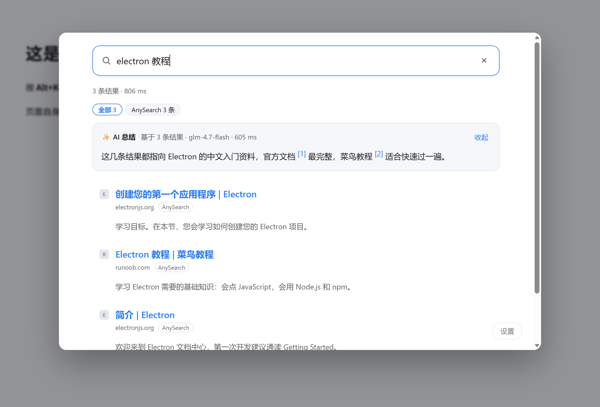

# Searchbox 油猴版（Tampermonkey）

与 `../searchbox/`（浏览器扩展版）并列的第二个运行时：**同一套核心逻辑，换一个外壳**。

- 可行性调研：[`../.sisyph/notes/2026-10-21-userscript-feasibility.md`](../.sisyph/notes/2026-10-21-userscript-feasibility.md)
- 为什么需要它：`AnySearch` 等接口没有 CORS 放行头（实测），普通网页调不通；`GM_xmlhttpRequest` 是唯一不装扩展也能绕开跨域的办法


## 安装

1. 浏览器装 **Tampermonkey**（Chrome / Edge / Firefox / Safari 都有）
2. 打开 [`dist/searchbox.user.js`](dist/searchbox.user.js)，复制全文 → Tampermonkey → 「添加新脚本」→ 粘贴 → 保存
3. 打开宿主页：**https://afeygu.github.io/searchbox/searchbox_script/host.html**
4. 建议把它设为浏览器主页或收藏，当作日常搜索入口

首次使用：右下角「设置」→ 勾选要用的搜索源、填 API Key（AnySearch 可留空）；想用 AI 总结再填接口地址与模型。

## 两种入口

### 1）宿主页（完整版）

打开 https://afeygu.github.io/searchbox/searchbox_script/host.html ，就是一个完整的搜索页。建议设为浏览器主页或收藏。

### 2）浮层（任意页面 Alt+K）



在**任何网页**上按 **Alt+K** 唤起搜索浮层，`Esc` 或点背景关闭。也可以在 Tampermonkey 的菜单里点「打开 Searchbox 搜索」。

实现方式是 iframe 承载宿主页——**不改动当前页面的 DOM 与样式**，因此不会和任何网站打架。代价是浮层每次打开都要加载一次宿主页（浏览器会缓存）。

## 它是什么形态

宿主页：一个**空页面**（`host.html`），界面与逻辑全部由脚本注入。选这个形态是因为油猴没有"自己的页面"，也没有新标签页接管能力——只能借一个真实地址当宿主。

浮层复用同一个宿主页：`host.html?embed=1` 会被嵌进 iframe，`Esc` 通过 `postMessage` 通知父页关闭（跨域下父页读不到子页按键）。

## 与扩展版的差异

| 能力 | 扩展版 | 油猴版 |
|---|---|---|
| 新标签页接管 | ✅ | ❌ 无此 API（用书签/主页代替） |
| 原生划词右键菜单 | ✅ | ❌ 不做 |
| 站点图标 | `chrome://favicon` | 首字母色块（SVG data URI） |
| 流式 AI 总结 | ✅ | ⚠️ 依赖 Tampermonkey 5.6.6242+ 的分块 `onprogress` |
| 存储 | `chrome.storage.local` | `GM_setValue` / `GM_getValue`（用一个键存 JSON） |
| 跨域请求 | host 权限 | `GM_xmlhttpRequest` + `@connect *` |
| 设置界面 | 独立设置页 + 测试面板 | 页内悬浮面板（精简） |
| 任意页面唤起 | ❌ | ✅ Alt+K 浮层 |

## 代码结构

```
searchbox_script/
├── host.html           宿主页（空白页，只被脚本接管）
├── src/
│   ├── store.js        chrome.storage.local → GM_*
│   ├── net.js          fetch → GM_xmlhttpRequest（含 SSE 流式）
│   ├── shell.js        注入 CSS 与 DOM（结构与扩展版 search.html 一致）
│   └── panel.js        页内设置面板
├── build.py            把共享核心 + 适配层拼成单文件
├── dist/searchbox.user.js   构建产物（就是要安装的那个）
└── dev/                本地调试用（GM_* 的浏览器内模拟 + 调试页）
```

**共享核心不在这里**：`../searchbox/src/core/` 与 `../searchbox/src/search.js` 是唯一实现，构建时原样拼进来（去掉 `import`/`export`）。改逻辑只改扩展那份，两边同时生效。

## 构建

```bash
cd searchbox_script
python build.py      # 输出 dist/searchbox.user.js
```

无第三方依赖。改完 `../searchbox/src/` 里的核心后必须重跑一次构建，否则油猴版还是旧逻辑。

## 本地调试（不需要 Tampermonkey）

```bash
# 任意静态服务器，根目录指向 searchbox_script/
python -m http.server 8791
# 打开 http://127.0.0.1:8791/dev/host-dev.html
```

`dev/gm-mock.js` 用 `localStorage` 与 `fetch` 模拟 `GM_*`。注意：因为模拟层用的是 `fetch`，**只能访问带 CORS 放行头的地址**；真实油猴环境不受此限制。

## 已知限制

- **`@match *://*/*`**：脚本会在所有页面加载（只挂一个快捷键监听，不渲染任何东西）。嫌侵入可以在 Tampermonkey 里改匹配规则
- **Alt+K** 可能与个别站点冲突；冲突时可在 Tampermonkey 设置里改脚本或改这里的热键
- 浮层是 iframe，**需要能访问 afeygu.github.io**（首次加载后浏览器会缓存）
- `@connect *` 是宽授权，因为搜索源由用户配置；Tampermonkey 首次访问新域名会询问
- 流式输出在旧版 Tampermonkey 上会退化成"等全部返回"
- 设置面板比扩展版简单：源的接口地址用 JSON 编辑，没有单源测试面板
